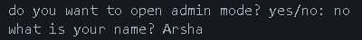
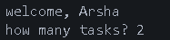
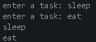
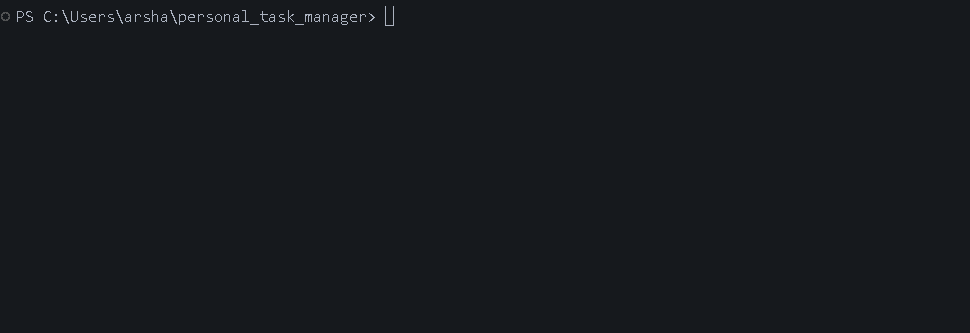

# Personal Task Manager


A simple task manager built with Python

## Table of contents

- [Features](#features)
- [Project Structure](#project-structure)
- [Requirements](#requirements)
- [Installation](#installation)
- [Environment Setup](#environment-setup)
- [Usage](#usage)
- [Example Output](#example-output)
- [Screenshot](#screenshot)
- [Demo](#demo)
- [Roadmap](#roadmap)
- [Contributing](#contributing)
- [License](#license)
- [Author](#author)

## Features
- Task System
  - Asks for the user's name
  - Lets the user add multiple tasks
  - Shows all the tasks
  - Lets you choose a priority (low, medium, high) for each task
  - Keeps asking until you type a valid priority
- Task Storage
  - Saves tasks in `tasks.txt`
  - Loads the saved tasks when the program starts
- Admin Mode
  - Asks for the admin password
  - Checks if the password is correct
  - Keeps the private information outside the main python file
  - Loads the password from `.env`

## Project Structure
```text
personal_task_manager/
│   .env.example
│   .gitignore
│   main.py
│   tasks.py
│   README.md
│   requirements.txt
│
├───gifs
│       demo.gif
│
├───pictures
│       1.png
│       2.png
│       3.png
```

### File Description
| file | description|
| --- | ---|
| `main.py` | main file used to run the task manager |
| `tasks.py` | the file that adds, shows, loads and saves the tasks|
| `requirements.txt` | lists the python packages needed for the project|
| `.env.example` | shows the environment variables needed by the project|
| `.gitignore` | tells git which files and folders should not be tracked|
| `README.md` | contains the project documentation|
| `pictures/` | stores project screenshots|
| `pictures/1.png`| screenshot of the program start|
| `pictures/2.png`| screenshot of adding tasks|
| `pictures/3.png`| screenshot of the task list|
| `gifs/`| stores demo GIF files|
| `gifs/demo.gif`| shows the project demo|

## Requirements
Before running the project make sure you have
- `python 3`
- `python-dotenv`

## Installation
1. open a terminal in the project folder
2. check if python is installed
```bash
python --version
```
3. install the python packages
```bash
pip install -r requirements.txt
```

## Environment Setup
1. create a `.env` file from `.env.example`:
```bash
cp .env.example .env
```

2. open the new `.env` file
3. replace the example value with your own password
```text
TASK_MANAGER_ADMIN_PASSWORD=your_password_here
```
4. save the file
> Do not commit your `.env` file because it may contain private information

## Usage
1. open a terminal in the project folder
2. run the task manager
```bash
python main.py
```
3. enter your name
4. choose `yes` or `no` for admin mode
5. if you choose `yes`, enter the password from your `.env` file
6. enter how many tasks you want to add
7. enter the tasks
8. see your task list
9. your tasks are saved in `tasks.txt`

## Example Output
```text
do you want to open admin mode? yes/no: no
what is your name? Arsha
welcome, Arsha
how many tasks? 2
enter a task: sleep
enter the priority of the task (low/medium/high): high
enter a task: eat
enter the priority of the task (low/medium/high): medium
sleep - high
eat - medium
```

## Screenshot

### start program

### adding tasks

### task list


## Demo


## Roadmap
- [x] ask for the name of the user
- [x] add multiple tasks
- [x] show all tasks
- [x] save tasks to a file
- [x] add admin mode
- [x] add priority to tasks
- [ ] add a nice list
- [ ] mark tasks as done
- [ ] delete tasks

## Contributing

## License

## Author
created by [Arsha Saiedi](https://github.com/arshasaiedi)